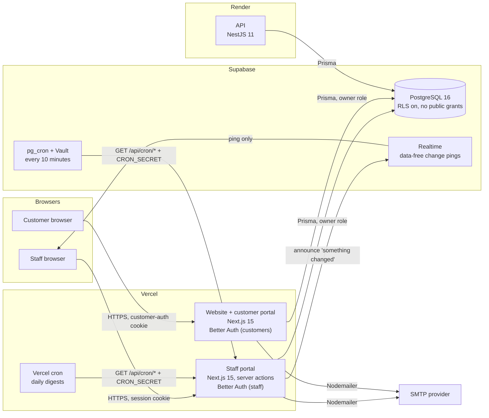

# EJO 100 Enterprise Platform

EJO 100 (internally "EnterpriseOS") is a multi-organisation ERP. Its first
organisation is Kewalram Chanrai Group in Nigeria, where it runs the
automobile workshop end to end: customers and vehicles, Job Cards and Vehicle
Services, estimates and approvals, parts and stock, payments and refunds,
warranty and claims, the security gate, scheduling and analytics. Customers
follow their own jobs on a customer portal.

This file is written for three readers: a reviewer (security, database or
enterprise), an investor who wants to see what exists, and an engineer joining
the project. Everything below describes what is built in this repository today;
planned work is labelled as planned.

- [What runs today](#what-runs-today)
- [Architecture](#architecture)
- [Tech stack](#tech-stack)
- [Security model](#security-model)
- [Testing](#testing)
- [Running it locally](#running-it-locally)
- [Environment variables](#environment-variables)
- [Deployment](#deployment)
- [Project structure](#project-structure)
- [Documentation](#documentation)
- [Roadmap](#roadmap)
- [Ownership and licence](#ownership-and-licence)

---

## What runs today

**Staff portal** (`apps/portal`, signed-in employees only)

| Module | What it does |
|---|---|
| Dashboard | Per-role landing page: work waiting for the person, live counts, quick links, the roadmap card. |
| Workshop: Job Cards | Repair jobs from check-in to check-out: supervisor and technician assignment, inspection, estimates with supervisor and manager approval, parts, payments, quality check, close and cancel requests, custody reminders. |
| Workshop: Vehicle Service | Scheduled servicing with the same controls as Job Cards (estimate stages, deposit rule, cancellation with refund, escalation to a Job Card). |
| Workshop: service tracker | Which vehicles are due or overdue for service, staged reminders in working days, sent by a person (never automatically). |
| Workshop: parts requests, outside purchases, refunds | Parts request slips (head of department, then Store), outside purchases (Finance review, Manager approval, cash disbursement), the refund register. |
| Customers (CRM) | Customer hub with search and filters, the customer 360 page (vehicles, jobs, payments, warranties, contacts, notes, activity), portal access and set-password links. |
| Inventory | Parts, stock and batches with FIFO cost back to the goods receipt, goods receipts, estimate matching, pricing and pricing alerts, Inventory Analytics. |
| Warranty | Providers, policies, vehicle and part warranties (certificates), claims with HOD and Manager approval, expiry reminders, Warranty Analytics. |
| Security | Visitors, contractors, deliveries, vehicles in and out, exit passes, road-test permits, incidents, the gate register, 80 mm slip prints. |
| Scheduling | Personal calendars, appointments, meeting rooms, aides who book for others, availability. |
| Business Analytics | Sales, cost, gross profit, collections, receivables and work in progress per period and branch; every figure links to the records behind it. |
| Support centre | Every support request in one place: emails to support@ / warranty@ / technical@ addresses, Enyo chat hand-overs and logged calls; teams with targets in business hours, fair assignment, acknowledgements, Enyo's triage, drafts and (where allowed) answers, reminders, satisfaction, and the numbers. See [docs/SUPPORT_CENTRE.md](docs/SUPPORT_CENTRE.md). |
| Enyo (AI) | The assistant in every page: answers from the records each person may see, the guide and the web; drafts (never submits) Job Cards, reminders and mail; voice notes (pause, edit as text, send) and read-aloud; the brief on the dashboard; tailored to each person's role and work; learns from approved answers, support resolutions and chats; small model for small talk, large for records. See [docs/ENYO_BRIEF_AND_LEARNING.md](docs/ENYO_BRIEF_AND_LEARNING.md). |
| Mail | Each person's own work mailbox (IMAP/SMTP, encrypted password): inbox with layout and pictures on request, compose in the organisation's letterhead with a live preview, Enyo's briefs and summaries read aloud. |
| Reminders | Personal reminders into the bell and by email, with colleagues allowed to set them for you. |
| Notifications | Action items, activity feed, email, staff and customer broadcasts with delivery figures. |
| Administration | Organisation, structure (business units, branches, departments, teams), users, roles, permissions, settings, audit logs. |
| Profile | Personal details, "what I can do" (generated from the permission catalogue), theme, password. |
| Print views | Estimates, receipts, parts slips, refunds, warranty certificates, gate passes (`app/print/**`). |
| Roadmap | One page per planned module (`/roadmap`), described in [Roadmap](#roadmap). |

**Public website and customer portal** (`apps/website`)

| Area | What it does |
|---|---|
| Website | The organisation's public site (about, businesses, products, services, careers, contact, privacy, terms). Carries the organisation's brand, not EJO's. |
| Customer portal (`/customer-portal`) | Sign-in, forgot and reset password, overview of what needs attention, my vehicles, my services (status timeline, estimate, payments, balance), payments, warranties, notifications, profile and addresses, help and support. |
| Support (`/support`, `/support/request/<token>`) | How to reach each support team, opening hours and branch phones; the customer's own page for a request (“Yes, solved” / “I still need a person” / “How did we do?”). |
| Enyo chat | On every page: answers about the organisation, and — signed in — the customer's own vehicles, jobs, estimates, payments and warranties; hands over to a person with a SUP number. |

**API** (`apps/api`, NestJS): a health check, and read routes for audit logs,
organisations, structure, users, roles and permissions that only the platform
team can call (`PlatformTeamGuard`). The other module folders are placeholders
that return nothing. Business logic lives in the portal's server actions, not in
the API.

---

## Architecture



How a request flows through the staff portal:

```
browser ─► middleware (sign-in cookie, submission flood limit, security headers)
        ─► page or server action
             requireUser()            session from the database; switched-off accounts refused
             authorize(permission, record)
                                      tenant fence → scope (ALL / BRANCH / DEPARTMENT / ASSIGNED / OWN)
             workflow check           compare-and-set on the expected status; row locks for money and stock
             Prisma write             data journal records before/after (secrets redacted)
             writeAuditLog(...)       plain-language business event
        ─► after the response         emails, realtime ping (failures never undo the action)
```

Key points:

- **One database, many organisations.** Every table is declared in
  `apps/portal/lib/governance/data-inventory.ts` with its tenancy (organisation,
  branch, department, user or via parent), sensitivity, lifecycle, retention and
  whether AI may read it. A CI test fails if a table is missing or its owner
  column does not exist.
- **Server actions call Prisma directly.** The portal does not go through the
  API for business work; the API is kept thin.
- **Two separate identity systems.** Staff (`User`, `Session`, `Account`,
  `Verification`) and customers (`Customer`, `CustomerSession`,
  `CustomerAccount`, `CustomerVerification`) are different tables with different
  cookies, so a customer token can never be used on the staff portal.
- **Realtime carries no data.** The portal sends "something changed" over
  Supabase Realtime; each browser then re-reads through the same permission
  checks. Without Supabase settings the browser checks `GET /api/live/pulse`
  every 10 seconds while the tab is in use.
- **Scheduled work** (`apps/portal/app/api/cron/*`) is protected by
  `CRON_SECRET` sent as a header and compared in constant time. Vercel runs the
  daily jobs (`apps/portal/vercel.json`); Supabase `pg_cron` calls the
  10-minute job (`scripts/v25-supabase-scheduler.sql`). Every run is recorded and
  shown on Settings.

Full detail: [docs/ARCHITECTURE_BASELINE.md](docs/ARCHITECTURE_BASELINE.md).

---

## Tech stack

Versions are the ones resolved in `package-lock.json` on 12 October 2026. The
dependency workstream may move them; refresh this table from the lockfile when
it does.

| Layer | Technology | Version |
|---|---|---|
| Runtime | Node.js | 24.x (`.node-version`: 24) |
| Language | TypeScript (strict) | 5.9.3 |
| Staff portal, website | Next.js (App Router, server actions) | 15.5.27 |
| UI | React | 19.3.0 |
| Styling | Tailwind CSS | 4.3.3 |
| Charts / motion / PDF | Recharts / Framer Motion / @react-pdf/renderer | 3.10.1 / 11.18.2 / 4.9.0 |
| Authentication | Better Auth (database sessions, HTTP-only cookies) | 1.6.33 |
| ORM | Prisma Client and CLI | 5.22.0 |
| Database | PostgreSQL on Supabase (CI: `postgres:16`) | 16 |
| API | NestJS (Express 5) | 11.2.7 |
| Email | Nodemailer over SMTP | 10.1.0 |
| Realtime | Supabase Realtime (broadcast) | hosted |
| E2E tests | Playwright | 1.64.0 |
| Security tools in CI | Gitleaks, Semgrep, OWASP ZAP baseline, npm audit | pinned in `.github/workflows/security.yml` |
| Load tests | k6 | pinned in `security.yml` |

Hosting: Vercel (portal and website), Render (API), Supabase (database,
realtime, `pg_cron`).

---

## Security model

| Control | Where | What it does |
|---|---|---|
| Permission catalogue | `apps/portal/lib/authz/catalogue.ts` | The only list of things that can be done (49 permissions at the time of writing), default grants for 17 organisation roles, five scopes (`ALL`, `BRANCH`, `DEPARTMENT`, `ASSIGNED`, `OWN`). Pure `decide()` function. The Permissions page is generated from the same file. |
| Enforcement | `apps/portal/lib/authz/server.ts` | `guardPage` for pages, `authorize` / `authorizeOn…` for actions, `allows` for buttons (same rule), `reachWhere` for lists, `seeOrNull` for records. Refusals are audited as `access.denied`. |
| Tenant fence | `decide()`, `reachWhere`, `orgWhere`, `orgOwned` | A record outside the person's organisation is refused before any scope is considered, including `ALL`. Out of reach and missing look the same ("not found"). |
| Segregation of duties | catalogue + workflow actions | Front desk opens jobs, supervisors approve estimates, managers give final approval and close, finance records money. Nobody approves their own close or cancel request; a manager cannot give final approval on a job they approved as supervisor. |
| Accounts | `lib/auth.ts`, `apps/website/lib/auth-customer.ts` | Public sign-up closed for staff and customers. Staff are added by an administrator and set their own password from an emailed link (no password is ever emailed). Switched-off accounts are refused at sign-in and on every request. |
| Database exposure | `scripts/postdeploy/0001-rls-default-deny.sql` | Row-level security on for every table with no policies, and no table, sequence or default privileges for Supabase's `anon` and `authenticated` roles. The app connects as the owner through Prisma. Re-applied after every production schema push. |
| Audit | `packages/database/src/audit-journal.ts`, `writeAuditLog` in `lib/workshop-core.ts` | Every data change journalled with before/after values (secrets redacted, rolled-back transactions dropped); every business step written as a named event with the person and organisation. Audit rows are never edited or deleted. |
| Integrity | `lib/integrity.ts` | Compare-and-set on workflow status, row locks for payments, refunds and stock, idempotency keys on payments, refunds and goods receipts. |
| Rate limits | `middleware.ts`, Better Auth config, API middleware | Submissions: 120 a minute per person, 1,500 per shared address. Sign-in: 20 a minute; password-reset requests: 5 per 5 minutes. Limits are per instance (a global limit needs an edge WAF). |
| Headers | `next.config.ts` (both apps) | HSTS, `X-Content-Type-Options`, `X-Frame-Options`, `Referrer-Policy`, `Permissions-Policy`, COOP, CORP, and a CSP with `default-src 'self'`. Signed-in portal pages and the customer portal use a per-request nonce with `'strict-dynamic'` (no `'unsafe-inline'` scripts); the static public pages keep a fixed policy. |
| Secrets | `.env` only, never the repository | Gitleaks scans the full history in CI. Only public values (`NEXT_PUBLIC_*`) reach the browser bundle; a CI scan checks the built bundles for secret values. |

Known limitations and the plan for each are listed in
[docs/V1_CLOSURE_REPORT.md](docs/V1_CLOSURE_REPORT.md) and
[docs/CUSTOMER_PORTAL_CRM_RELEASE.md](docs/CUSTOMER_PORTAL_CRM_RELEASE.md).

---

## Testing

| Suite | Command / location | Covers |
|---|---|---|
| Unit and source tests | `cd apps/portal && npm test` (`apps/portal/tests/`) | Catalogue decisions (allowed and denied), guard coverage (every exported server action authorises), tenant coverage (reads by id are fenced), data inventory completeness, integrity coverage, analytics reconciled against hand-worked answers. |
| Database tests | `apps/portal/tests/concurrency.db.test.ts`, `packages/database/tests/` | Real parallel transactions on a throwaway PostgreSQL (lock SQL, deadlock control); audit journal rules. |
| End-to-end | `.github/workflows/e2e.yml`, `apps/portal/e2e/` | Playwright against production builds of both apps, Postgres 16 and Mailpit. 135 tests on the last full run, one account per role, real emails opened and links followed, cross-organisation attempts. |
| Security | `.github/workflows/security.yml` | Gitleaks (all history), Semgrep (registry packs and project rules), npm audit, OWASP ZAP baseline, access-control sweeps (role × page, IDOR, signed-out calls to every server action), RLS probes as `anon` / `authenticated`, concurrency bursts. |
| Load | `ops/load-test/` (k6) | Smoke, baseline, ramp, spike, soak and recovery stages, plus a two-instance failover. Figures in the release reports. |

CI (`ci.yml`) runs install, database build, lint, typecheck, unit tests and a
full production build on every push and pull request. The E2E and security
workflows run on pull requests to `main`. None of them touch production.

---

## Running it locally

Requirements: Node.js 24, npm, and a PostgreSQL 16 database (local or a
Supabase project you own for development).

```bash
npm install                       # also runs prisma generate
cp .env.example .env              # fill in your own values; never commit .env

# Create the tables in YOUR development database (never point this at production)
npx prisma db push --schema=packages/database/prisma/schema.prisma

# First organisation, roles and the platform administrator (needs MASTER_ADMIN_* set)
npm run seed --workspace=packages/database

npm run dev:portal                # http://localhost:3001
npm run dev:website               # http://localhost:3000 (customer portal at /customer-portal)
npm run dev:api                   # http://localhost:4000/api/v1
```

Emails: point `SMTP_*` at a local catcher such as Mailpit (`localhost:1025`) so
nothing reaches a real inbox. Realtime is optional; without the Supabase
settings the portal falls back to the 10-second check.

Checks before a pull request:

```bash
cd apps/portal && npx tsc --noEmit -p . && npm test
cd apps/website && npx tsc --noEmit -p .
```

---

## Environment variables

Names only. Values live in `.env` locally and in the Vercel / Render dashboards
in production. `.env.example` has placeholders. The dependency workstream is
centralising configuration (`apps/portal/lib/site-config.ts`, website
`lib/branding.ts`); refresh this table if names change.

| Name | Used by | Required | Purpose |
|---|---|---|---|
| `DATABASE_URL` | portal, website, API, Prisma | Required | Pooled PostgreSQL connection used at runtime. |
| `DIRECT_URL` | Prisma, deploy scripts | Required | Direct (unpooled) connection for `prisma db push` and deploy SQL. |
| `BETTER_AUTH_SECRET` | portal, website | Required | Signs session cookies. Rotating it signs everyone out. |
| `BETTER_AUTH_URL` | portal | Required | The portal's own public address, for auth callbacks. |
| `NEXT_PUBLIC_PORTAL_URL` | portal, website, API | Required | Public address of the staff portal (links in emails, API CORS allow-list). |
| `NEXT_PUBLIC_WEBSITE_URL` | portal, website | Required | Public address of the website; customer set-password and reset links point here. |
| `SMTP_HOST`, `SMTP_PORT`, `SMTP_USER`, `SMTP_PASSWORD`, `SMTP_FROM` | portal, website | Required for email | Outgoing mail. `SMTP_PASS` is accepted as a fallback for `SMTP_PASSWORD`. Port 465 uses TLS directly. |
| `CRON_SECRET` | portal | Required for scheduled jobs | Bearer token the scheduled routes require. Also stored in Supabase Vault for `pg_cron`. |
| `PLATFORM_OWNER_EMAIL` | portal | Required | The platform owner account, which only the owner can change. |
| `NEXT_PUBLIC_SUPABASE_URL`, `NEXT_PUBLIC_SUPABASE_ANON_KEY` | portal | Optional | Realtime change pings. Public by design; safe only because RLS denies these roles everything. Never use the service-role key here. |
| `NEXT_PUBLIC_ACTIVE_ORGANISATION_SLUG` | website | Optional | Which organisation's branding the website shows. |
| `AUTH_SIGNIN_PER_MINUTE`, `AUTH_RESET_REQUESTS_PER_5_MIN` | portal | Optional | Override the staff sign-in and reset-request limits (defaults 20 and 5). |
| `CUSTOMER_SIGNIN_PER_MINUTE`, `CUSTOMER_RESET_REQUESTS_PER_5_MIN` | website | Optional | Same limits for the customer portal. |
| `MASTER_ADMIN_NAME`, `MASTER_ADMIN_EMAIL`, `MASTER_ADMIN_PASSWORD` | seed only | Required to seed | The platform administrator created by `prisma/seed.ts`. Not read by the running apps. |
| `MAILBOX_ENCRYPTION_KEY` | portal | Required for Mail and support addresses | 32 bytes, base64. Encrypts mailbox passwords (AES-256-GCM). Losing it means reconnecting every mailbox. |
| `ENYO_LLM_BASE_URL`, `ENYO_LLM_API_KEY`, `ENYO_LLM_MODEL`, `ENYO_LLM_FAST_MODEL` | portal, website | Required for Enyo | Any OpenAI-compatible server (e.g. Groq: `openai/gpt-oss-120b` and `openai/gpt-oss-20b`). |
| `ENYO_LLM_PROVIDER_LABEL`, `ENYO_LLM_TIMEOUT_MS`, `ENYO_LLM_ROUTING`, `ENYO_WEB_LOOKUP`, `ENYO_REQUESTS_PER_MINUTE`, `ENYO_IP_HASH_KEY` | portal, website | Optional | Name shown in Settings, time limit, `off` to send everything to the large model, `off` to stop web look-ups, per-person rate, hashing of visitor addresses. |
| `NEXT_PUBLIC_DEALER_BRANDS` | portal, website | Optional | Dealer brands in the email footer, e.g. `FOTON:#111111,ISUZU:#E4002B,SOUEAST:#F39800`. |
| `NEXT_PUBLIC_APP_SHORT_NAME` | portal, website | Optional | Name of the installed app (default: the organisation's initials, e.g. KCG). |
| `WEBSITE_ORGANISATION_SLUG` | website | Optional | Which organisation the website and its chat belong to. |
| `MAILBOX_ALLOW_INSECURE` | portal | Test only | Allows unencrypted mail servers in tests. Never in production. |
| `PORT` | API | Optional | API port (default 4000). |
| `VERCEL_ENV`, `RENDER`, `IS_PULL_REQUEST` | deploy scripts | Set by the host | Decide whether a build may change the database (production only). |

`.env.example` also lists `REDIS_URL`, `SUPABASE_URL`,
`SUPABASE_SERVICE_ROLE_KEY`, `SUPABASE_STORAGE_BUCKET`, the `R2_*` storage
names and `NEXT_PUBLIC_API_URL`. No code reads them today; they are reserved for
file storage and caching when those are built. Its `NEXT_PUBLIC_ACTIVE_COMPANY_SLUG`
is an old name: the website reads `NEXT_PUBLIC_ACTIVE_ORGANISATION_SLUG`.

---

## Deployment

```
pull request ─► CI (build, tests, E2E, security) ─► Vercel preview (never touches the database)
             ─► owner merges to main
             ─► production build:
                  1. scripts/predeploy/*.sql    additive, re-runnable SQL (new indexes, backfills)
                  2. prisma db push             without --accept-data-loss: anything destructive stops the deploy
                  3. scripts/postdeploy/*.sql   RLS default-deny on every table, data clean-ups
```

- The schema push runs from `scripts/db-push-if-render.js` (Render API build)
  or `scripts/db-push-if-vercel.js` (Vercel production build), whichever the
  hosting dashboard is configured to call. Both skip previews and pull requests.
- **No data-loss rule:** `--accept-data-loss` is never used. A change that would
  drop a column or table is made deliberately with a reviewed SQL script and a
  backup first. SQL scripts in `scripts/` are additive and safe to run twice.
- Rollback: Vercel and Render keep previous deployments (instant rollback).
  Database changes are additive, so the previous code still runs against the
  newer schema.
- Supabase daily backups; recovery targets and the restore drill are in
  [docs/RUNBOOKS.md](docs/RUNBOOKS.md).

---

## Project structure

```
ejo100/
├── apps/
│   ├── portal/                 staff ERP (Next.js)
│   │   ├── app/(app)/          signed-in pages, one folder per module
│   │   ├── app/(auth)/         sign-in, forgot / reset password
│   │   ├── app/print/          printable documents
│   │   ├── app/api/            auth, health, live pulse, cron routes
│   │   ├── lib/actions/        server actions ('use server'), one file per area
│   │   ├── lib/authz/          permission catalogue and enforcement
│   │   ├── lib/governance/     data inventory
│   │   ├── lib/email-templates/
│   │   ├── components/
│   │   ├── tests/              unit and source-coverage tests (node --test)
│   │   └── e2e/                Playwright specs, seed, security sweeps
│   ├── website/                public website + customer portal (Next.js)
│   └── api/                    NestJS API (health, audit logs, platform routes)
├── packages/
│   ├── database/               Prisma schema, client, audit journal, seed
│   ├── ui/                     shared React components
│   ├── types/                  shared TypeScript types
│   ├── utils/                  framework-free helpers
│   └── config/                 shared design tokens
├── scripts/                    deploy scripts and reviewed SQL (predeploy/, postdeploy/, vNN-*.sql)
├── ops/load-test/              k6 scripts and the failover proxy
├── docs/                       architecture, readiness, runbooks, test reports
└── .github/workflows/          ci.yml, e2e.yml, security.yml
```

---

## Documentation

| Document | For |
|---|---|
| [docs/ARCHITECTURE_BASELINE.md](docs/ARCHITECTURE_BASELINE.md) | The binding rules and the architecture as built: identity, tenancy, roles, permissions, audit, integrity, deployment. |
| [docs/AI_READINESS.md](docs/AI_READINESS.md) | What the AI phase may read, how it stays inside the tenant fence, and the service boundary. |
| [docs/PRODUCTION_READINESS.md](docs/PRODUCTION_READINESS.md) | What is verified, what is deliberately deferred, remaining risks. |
| [docs/RUNBOOKS.md](docs/RUNBOOKS.md) | GitHub hardening, Supabase checks, staging, restore drill, load test, failure drills. |
| [docs/V1_CLOSURE_REPORT.md](docs/V1_CLOSURE_REPORT.md) | Version 1 findings register, load baseline, metric definitions. |
| [docs/CUSTOMER_PORTAL_CRM_RELEASE.md](docs/CUSTOMER_PORTAL_CRM_RELEASE.md) | Customer portal and CRM release, test programme summary. |
| [docs/TESTING_PROGRAMME.md](docs/TESTING_PROGRAMME.md) | Security, concurrency and load findings in detail. |
| [docs/E2E_COVERAGE.md](docs/E2E_COVERAGE.md) | Playwright coverage matrix and defects found. |
| [docs/MASTER_PLAN.md](docs/MASTER_PLAN.md) | Phase history and the list of carried-over requests. |
| [docs/SUPPORT_CENTRE.md](docs/SUPPORT_CENTRE.md) | The Support centre: flow, teams and addresses, safety rules, numbers, learning, running it. |
| [docs/ENYO_RELEASE.md](docs/ENYO_RELEASE.md), [docs/ML.md](docs/ML.md), [docs/ENYO_BRIEF_AND_LEARNING.md](docs/ENYO_BRIEF_AND_LEARNING.md) | Enyo (AI), its trained models, the brief and how it learns. |
| [docs/architecture.md](docs/architecture.md), [docs/folder-structure.md](docs/folder-structure.md), [docs/coding-standards.md](docs/coding-standards.md), [docs/module-creation-guide.md](docs/module-creation-guide.md) | Conventions for engineers adding to the codebase. |

---

## Roadmap

Planned modules are described in the portal at `/roadmap`, one page each, from
`apps/portal/lib/roadmap.ts`. Each page lists what the module will do, how it
will work (data model, permissions, delivery order) and which live records it
builds on.

**Next: the AI phase**
- **AI support centre**: the customer side is live (Support centre, v36); next
  is the staff help desk (“something is wrong here” from any page).
- **Intelligence**: forecasting (parts demand, workshop load, revenue) and
  anomaly detection, in a separate Python service that reads curated data only.
  The rules for this phase are in [docs/AI_READINESS.md](docs/AI_READINESS.md).

**Then, by area**
- People & performance: HR & People, Payroll, Targets & performance.
- Everyday work: Messages (chat with official, recorded messages), Approvals &
  workflow designer, Documents & e-signature, Quality & checklists, Technician app.
- Customers & sales: Sales & CRM pipeline, Vehicle sales, Service plans &
  contracts, Customer feedback, Price lists, promotions & loyalty, Fleet &
  business accounts, Customer app.
- Buying, stock & assets: Procurement, Suppliers, Warehouse, Manufacturing,
  Fixed assets & tools.
- Finance & tax: Finance & accounting (with budgets), Tax & e-invoicing (NRS MBS).
- Data & platform: Reports, Data warehouse & BI, Integrations, Branding.

---

## Ownership and licence

Proprietary software. The repository is private and no licence is granted by
its contents; use, copying or deployment needs the written permission of the
platform owner. Organisation data stored by a deployment belongs to that
organisation and is handled under the Nigeria Data Protection Act 2023.
